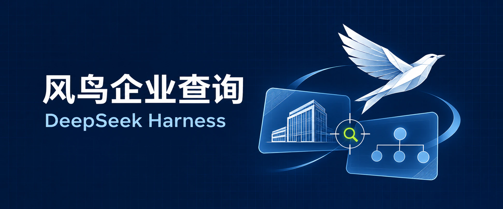

# 风鸟企业查询

[](https://www.npmjs.com/package/dsh-fengniao-company-search)
[](LICENSE)

在 DeepSeek Harness（DSH）对话里，用中文企业名称查询工商登记、股东、高管、对外投资及司法与经营风险。Agent 通过风鸟（Riskbird）定位企业主体，再从 11 个维度中查询所需信息。检索候选和查询结果都可以在对话卡片中展开查看。

*Riskbird company lookup for DeepSeek Harness. Find Chinese companies by name and query 11 registration, ownership, and risk dimensions.*

## 快速开始

适用 DSH `>=0.1.7-rc.1 <0.3.0-0`。插件需要 Node.js 20 或更高版本，使用 DSH 自带的运行环境即可。

1. 在 DSH 打开「插件 → 添加插件 → 安装第三方插件」，在「包名或地址」中填写 `dsh-fengniao-company-search`。
2. 登录风鸟，在「账户设置 → API Key」生成个人 API Key。 [风鸟 Web](https://www.riskbird.com)
3. 打开 DSH 的「插件 → 风鸟企业查询」，粘贴 Key 并点击「保存」，再用「测试连接」确认可用。Key 保存到本机 Harness 凭据库，卡片只显示掩码和尾号。
4. 在对话中提出查询，例如「查一下腾讯科技（深圳）有限公司的工商基本信息和被执行人记录」。

> 旧版仅通过 `FN_API_KEY` 配置的用户，升级后需在插件页重新保存 API Key。

### 其他安装方式

- **指定 npm 版本**可填写 `dsh-fengniao-company-search@<版本>`。
- **GitHub 源码**可填写仓库地址，或填写克隆后目录的绝对路径。 [GitHub 仓库](https://github.com/keyblues/dsh-fengniao-company-search)
- **离线安装**可填写下载后的 `.tgz` 文件绝对路径。 [GitHub Releases](https://github.com/keyblues/dsh-fengniao-company-search/releases)

如果更新后 DSH 提示重启，重启后会加载新版插件。 [DSH 插件管理文档](https://github.com/deepseek-ai/deepseek-harness/blob/master/packages/boot/plugin-manager/README.zh.md)

## 查询工具

| Agent 工具 | 输入 | 返回 |
| --- | --- | --- |
| `fengniao_search_company` | `keyword`，企业中文全称或简称 | 最多 20 个候选，包含上游提供的企业名称、`entid`、经营状态和原始记录 |
| `fengniao_company_dimension` | `entid` 和 `dimension` | 单个维度的上游数据 `data`、接口码 `apiCode` 和结果状态 `state` |

遇到同名或近似主体时，先确认企业全称。查询同一企业的多个维度时，可复用检索结果中的 `entid`。每次维度查询消耗一次接口额度，「测试连接」也会向风鸟发送一次检索请求。

`state` 为 `records` 时表示查到记录，为 `empty` 时表示该维度暂无记录，为 `unknown` 时表示无法根据返回结构判断。结果过大时，Harness 可能将完整结果写入文件，对话卡片仍可显示查询摘要。

### 支持的查询维度

| `dimension` | 查询内容 | 风鸟接口版本码 |
| --- | --- | --- |
| `basic_info` | 企业基本信息 | `B1` |
| `shareholders` | 企业股东信息 | `B2` |
| `executives` | 企业高级职员 | `B3` |
| `investments` | 企业对外投资 | `B4` |
| `changes` | 企业工商变更 | `B5` |
| `executed` | 被执行人 | `C2` |
| `dishonest` | 失信被执行人 | `C3` |
| `limit_consumption` | 限制高消费 | `C4` |
| `abnormal_operation` | 经营异常 | `D1` |
| `serious_illegal` | 严重违法 | `D2` |
| `admin_penalty` | 行政处罚 | `D11` |

## 进阶配置

如需覆盖默认值，可在 DSH profile 的 `cordis.patch.yml` 中为 `fengniao-company-search` 设置以下配置项。

| 配置项 | 默认值 | 用途 |
| --- | --- | --- |
| `apiKey` | 空 | 直接配置的 API Key，优先于 Harness 凭据 |
| `credentialRef` | `FENGNIAO_API_KEY` | Harness 解析的凭据引用，也是插件页保存 Key 的位置 |
| `baseUrl` | `https://m.riskbird.com/prod-qbb-api` | 风鸟接口地址，联调时可覆盖 |
| `timeoutMs` | `30000` | 单次请求超时，范围为 `5000`–`120000` 毫秒 |

风鸟接口要求通过请求 URL 的 `apikey` 参数传递 Key。接口和代理的访问日志可能记录完整 URL。

## 常见问题

- **配置接口不可达**时，等 DSH 的 Web 服务启动后刷新插件详情页。
- **接口码 `9999`** 表示 Key 无效或已达每日调用上限。在风鸟的 API Key 页面核对 Key 和剩余额度。
- **接口码 `8888`** 表示 `entid` 或查询参数有误。重新检索企业获取 `entid`，并检查所选维度。

## 开发与发布

插件无需安装 npm 依赖或执行构建。`index.js` 注册工具、调用风鸟 API 并挂载配置接口，`client.js` 渲染插件配置页和对话卡片，`cordis.patch.yml` 是 DSH 的 bundle 清单。

```sh
npm test
```

测试使用 Node.js 内置运行器和模拟上游响应，覆盖工具输出契约、凭据读写、设置接口和卡片渲染。

推送与 `package.json` 版本匹配的 `v*` 标签后，GitHub Actions 会运行测试，通过 npm Trusted Publishing 发布，并将 `.tgz` 附到 GitHub Release。 [发布工作流](.github/workflows/publish.yml)

## 许可证

[MIT](LICENSE) © keyblues
